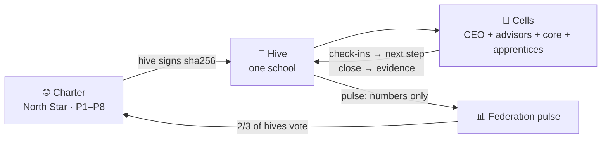

# 🐝 Alumni Honeycomb · 校友蜂巢

**Live, everywhere including mainland China:** https://futuremake.io/honeycomb · **📅 First online meeting: Sat Dec 5, 5 PM Pacific / Sun Dec 6, 9 AM Beijing, sign up on the page** (it asks your consent to store the reminder details on a US server; never your faith or a child's details) · backup mirror: https://wjlgatech.github.io/alumni-honeycomb

中文 first, English one tap away · installable on any phone · measured from mainland probes, not assumed ([CHINA-ACCESS](docs/CHINA-ACCESS.md))

> **Every student, every season, is the CEO of something they love, while coaching others and being coached.**
> 每一个学生，每一季都是某件自己热爱之事的 CEO，同时也在辅导别人、被别人辅导。

An open-source kit for an **international alumni ecosystem**. Alumni walk with students before the door
(admission, hiring), through it (professional and leadership growth) and beyond it (jobs and ventures). They walk as
companions in **spirit, mind, heart and strategy**, not only as people who open a door. Each school runs its own
**hive**, and all hives keep one shared **charter**.

Read it in three levels. Stop when you have what you need.

---

## Level 1 · The concept (one minute)

**Why.** Many students we met in China fear that AI will make them obsolete before they start. These were our
schoolmates' children and students at SYSU, Peking, Tsinghua, Fudan, Zhejiang and other universities. We believe
everyone has a calling and worth that no technology changes. AI is an amplifier: one person's unique experience and
conviction, multiplied ×10, ×100 or ×1000, can walk them out of the old script.

**The picture: a honeycomb.** Picture a small kitchen brigade that cooks one dish for one season. One person had the
idea and leads it (the **CEO**). Two or three experienced chefs drop by to guide (the **advisors**, who are alumni). Two
or three teammates cook alongside (the **core**). Two or three newcomers learn by doing (the **apprentices**). Next
season the same person may be an apprentice in a friend's kitchen and an advisor in a third. Over four years of college
that is about **12 seasons**: 12 times coached, many more times coaching others, and 12 things led.

```
        🦉 advisor   🦉 advisor
   🛡 core     👑 CEO     🛡 core          one cell = 1 CEO + 2–3 advisors + 2–3 core + 2–3 apprentices
        🌱 apprentice 🌱 apprentice         one season = 3 months · roles switch between cells
```

**The rule that makes it different:** at any time, you are the CEO of *something* you have a vision and a conviction
for. Roles flow with your stage of growth. None of them is fixed.

---

## Level 2 · The architecture (ten minutes)

Three layers, smallest first:

| Layer | Plain idea | Exact handle |
|---|---|---|
| 🔶 **Cell** | one team, one thing, one season | `cells[]` in a hive file: `ceo`, `advisors`, `core`, `apprentices`, `vision`, `good`, `status` |
| 🐝 **Hive** | one school runs itself | one YAML file per school, `hives-private/<school>.yml` (never committed) |
| 🌐 **Federation** | all hives keep one charter; nobody gives orders | `data/charter.yml` (signed by SHA-256) + `data/federation.yml` (registry, proposals) |



**Decentralized, without a token.** We keep the ideas of web3 and leave out the chain. The protocol is a file anyone can
fork. Membership is a hash anyone can verify. Each school owns its data. Rule changes need 2/3 of hives, one hive one vote.
Any hive can fork and leave. There is no token: it would be illegal in mainland China, and student data must never sit on
a public ledger. Details: [docs/ARCHITECTURE.md §3](docs/ARCHITECTURE.md), [docs/GOVERNANCE.md](docs/GOVERNANCE.md).

**Many schools, one rhythm: synchronize · harmonize · compound.** Every hive uses the same season clock and publishes a
public feed once a season (its heartbeat). Every feed is signed with the charter's fingerprint. Every closed cell
becomes a learning card (no names), which cells at other schools read before they start and cite in `builds_on`.
When a tag appears in 3+ cards from 2+ schools, the steward drafts a shared playbook, and the hives vote. Research
and handles: [docs/FEDERATION.md](docs/FEDERATION.md).

**The committee empowers; it doesn't command.** One steward per hive sits on the Council. It keeps the charter, trains new
operators, maintains this code and publishes the federation's numbers. It never chooses a hive's members, holds its
roster or charges anything. [docs/GOVERNANCE.md](docs/GOVERNANCE.md)

**Reachable from China.** The page loads nothing from other domains (no foreign fonts, CDNs or analytics; a test enforces it)
and uses relative paths, so the same `web/` folder runs on any host. The origin deploy (`*.vercel.app`) is DNS-poisoned on the
mainland, so the public address is **futuremake.io/honeycomb**: futuremake.io's edge proxies the origin, and the browser only
ever talks to futuremake.io. `make china` measures it from mainland probes: [docs/CHINA-ACCESS.md](docs/CHINA-ACCESS.md).

**The personal first step: the Calling Compass.** Eight questions, two minutes, scored only in your browser. It shows where
you stand in spirit, mind, heart and strategy, then asks you to write one experience others don't have. That sentence may
be what you lead as CEO next season.

---

## Level 3 · For implementers and operators

### Run it

```bash
pip install pyyaml pytest              # the only dependencies
make check                             # data drift · charter rules · federation · tests · quality floor
make demo                              # the site at http://127.0.0.1:8799
make deploy                            # Vercel production + live check
make mirror                            # GitHub Pages mirror (mainland China) + live check
make china                             # measure both URLs from mainland probes (Globalping, free)
python -m honeycomb check   hives/example/hive.yml          # P1–P6 on a hive file; exit 1 on any problem
python -m honeycomb pulse   hives/example/hive.yml          # vital signs + the 10X targets
python -m honeycomb recruit hives/example/hive.yml c-calling-salon   # shortlist for empty seats
python -m honeycomb federation check | hash | pull           # verify / charter fingerprint / merge every feed
python -m honeycomb publish hives/example/hive.yml           # the public feed: numbers, learning cards, open seats
python -m honeycomb learn   hives/example-b/hive.yml c-history-ai   # what other hives already learned
python -m honeycomb compass 3 2 1 1 2 0 3 3                  # score 8 compass answers
```

### A hive file, in one screen

```yaml
hive:     {id, school_zh, school_en, simulated, operator, charter: {version, sha256}}
members:  - {id, name, type: student|alumnus, school, field, languages, age_band, guardian}   # pseudonyms only
seasons:  - {id: 2026-S4, start: 2026-10-01, end: 2026-12-31}
cells:    - {id, season, status: forming|active|closed, ceo, vision, good: "Good: …",
             advisors: [2–3 alumni], core: [2–3], apprentices: [2–3], outcome: {evidence, learned}}
checkins: - {cell, date, dims: [spirit|mind|heart|strategy], next_step}
```

A full simulated example: [`hives/example/hive.yml`](hives/example/hive.yml) (10 people, 4 cells, 2 seasons, 4 role-switchers). Cells also carry `tags: [...]` and, when they build on another cell's learning card, `builds_on: [<hive>/<cell>]`.

### The charter's principles and the code that enforces them

| Principle | Enforced by |
|---|---|
| P1 cell = 1 CEO + 2–3 advisors (alumni) + 2–3 core + 2–3 apprentices, one season | `check.cell_shape` |
| P2 a vision and a `Good:` success criterion before acting | `check.vision_and_good` |
| P3 a closed cell records what was observed | `check.closed_has_evidence` |
| P4 every check-in ends in a written next step | `check.checkin_next_step` |
| P5 at most 3 roles and 1 CEO role per person per season | `check.capacity` |
| P6 guardians for minors, pseudonyms, no contact details | `check.safety` |
| P7 no fees, no selling, no tokens | the Council |
| P8 share learnings, never people: closed cells carry tags + `learned` | `check.closed_shares_learning`, `feed.leaks` |

### The 10X, defined so it can fail

| ID | Measure (`honeycomb/pulse.py`) | Target | Due |
|---|---|---|---|
| T1 | `active_cells` in the first real hive | ≥ 2 | 2026-12-19 |
| T2 | `role_switchers` (2+ different roles held) | ≥ 3 | 2027-03-31 |
| T3 | `hives` registered, non-simulated | ≥ 2 | 2027-06-30 |
| T4 | `cross_hive_builds_on`: a cell builds on another school's learning card | ≥ 1 | 2027-06-30 |

If T1 is below 1 on 2026-12-19: no second school, no feature, no token. Ask the people who stopped why. ([docs/SPEC.md](docs/SPEC.md) §0)

### Before the first meeting: 1:1s with the people others listen to

The first public meeting goes better when the cells already have their first members before anyone joins the call. So before Dec 5 we meet 6–8 people one at a time.
Most of them are **hubs**, people their circle listens to. Two are the actual users, and one is a skeptic who expects it to fail.
**People first, business second.** Each 1:1 is a relationship before it is research: we ask what they are building and give something first. Then we ask only about things that already happened. We record what they *did* at the end, not what they said. Technology does the tallying and never stands in for the meeting.

| Step | Command (real files stay in `hives-private/discovery/`) |
|---|---|
| Whom to meet, with a reason per pick | `python -m honeycomb discovery plan <people.yml>` |
| The bilingual question card to carry in | [docs/DISCOVERY-CARD.md](docs/DISCOVERY-CARD.md) (generated, drift-gated) |
| What we learned, as numbers + which pre-committed rule fires | `python -m honeycomb discovery tally <interviews.yml>` · `make discover` |
| Sign your phone into the room (scan once, good for 30 days) | `make signin` |
| One private place to run it all, on the phone: who's next, what to ask them, log the talk, live numbers | https://futuremake.io/honeycomb/room.html (owner only; the page holds no names) · `discovery push` sends the snapshot, `discovery pull` brings phone notes back |

The 12X, defined so it can fail: **12 committed seats before Dec 5** (`seats_committed`; walking in cold, the start is about 1).
The guide, the research behind it and the rules: [docs/DISCOVERY.md](docs/DISCOVERY.md).

### Your member card

Trust grows with the role's risk. Each school claim earns a level (stated · supported · confirmed) from several small proofs:
a school email, a degree registry report, a thesis, classmates who vouch and say how they know you. A student can lead
with no proof. An advisor needs some proof. Working with a minor needs a safety screen, which a diploma never replaces.
Each member also runs their own season loop: purpose, one goal with a "Good:" line, a weekly line, a review.
No passwords: a member signs in with a one-time code to one confirmed contact. Every member is invited by a member, and nothing rewards headcount, so fake cards earn nothing.
`python -m honeycomb member check|card <card.yml>` · rules in `data/membership.yml` · the why and the scenarios in [MEMBERSHIP.md](docs/MEMBERSHIP.md).

### Start a hive at your school

Fork → write `hives-private/<school>.yml` → `check` until green → put `federation hash` in your file → PR one row into
`data/federation.yml`. Full steps: [docs/GOVERNANCE.md](docs/GOVERNANCE.md#how-a-hive-joins).

### Repo map

| Path | What |
|---|---|
| `data/` | the single source of truth: charter, honeycomb model, federation, strategy, compass, arc, dimensions, boundaries, site |
| `honeycomb/` | the engine: `check`, `pulse`, `recruit`, `federation`, `compass`, `discovery` (pre-launch 1:1s), `member` (member cards), `build`, CLI (`__main__`) |
| `hives/example/`, `hives/example-b/` | two simulated hives (and their public `feed.json`); real hives live in `hives-private/` (gitignored) |
| `federation/index.json` | every feed merged: sync status, learning cards, open seats, ripe drafts (generated, drift-gated) |
| `web/` | the static site; `data.json` is generated from `data/` and drift-gated |
| `scripts/` | `icons.py` (pure-Python PNGs), `live_check.py`, `publish_mirror.sh`, `china_probe.py`, `score.py` (quality ratchet; floor in `data/quality-floor.json`) |
| `docs/` | [SPEC](docs/SPEC.md) · [ARCHITECTURE](docs/ARCHITECTURE.md) · [GOVERNANCE](docs/GOVERNANCE.md) · [CHINA-ACCESS](docs/CHINA-ACCESS.md) · [FEDERATION](docs/FEDERATION.md) · [DISCOVERY](docs/DISCOVERY.md) · [MEMBERSHIP](docs/MEMBERSHIP.md) · [STATUS](docs/STATUS.md) |

### Honest edges

- No server, logins or database yet. A hive of 10–50 people runs on one file and a group chat; the app comes when an operator says the file is the bottleneck.
- `recruit` is rule-based (shared language, same field, capacity, role eligibility). It drafts a shortlist; the CEO recruits.
- The example hive is fiction. Its numbers prove the tools run; they are not the 10X.
- A volunteer alumni project. It does not represent any university or company.

Sibling communities, linked from the page: [ALL-IN AI 2027](https://futuremake.io/all-in-ai) · [FM-SC](https://fmsc.futuremake.io/) · [Stanford Eden](https://eden.futuremake.io/) · [the FutureMake Ecosystem](https://futuremake.io/hub/ecosystem).

MIT licensed. Lineage: the loop discipline comes from Stanford Eden's core-team app, and the "each engagement compounds the
next" idea comes from Future Makers Strategic Collab.
