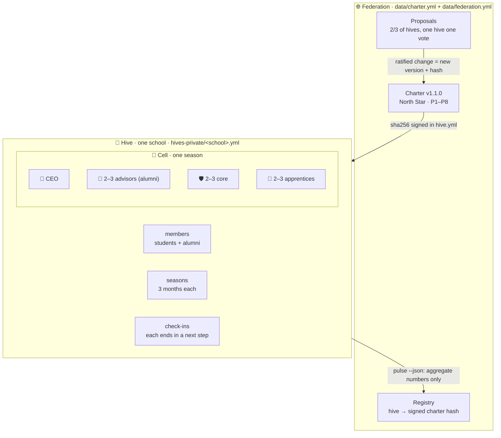

# Architecture

Three levels, like the website: **concept → structure → the exact handles**. Read only as far as you need.

## Level 1 · Concept (one minute)

A beehive is a good picture. Each **cell** is one small team doing one thing for one season. Each **hive** is one
school, running itself. The **federation** is the agreement all hives keep, written in one file. Nobody at the top
gives orders. Every hive signs the same rules, and anyone can check a signature.

## Level 2 · Structure (ten minutes)



### The four roles, and why they switch

| Plain idea | Exact handle |
|---|---|
| The person with the vision leads | `cells[].ceo`, one per cell; at most one CEO role per person per season (`capacity.ceo_per_season`) |
| People who walked the road guide | `cells[].advisors`, 2–3, must have `type: alumnus` (any school) |
| Peers make it happen | `cells[].core`, 2–3 |
| Newcomers learn by doing | `cells[].apprentices`, 2–3 |
| One person, different roles in different cells | roles are per cell, not per person; `pulse.role_switchers` counts people with 2+ distinct roles |
| Passion must be sustainable | at most 3 roles per person per season (`capacity.roles_per_season`) |

### The cell's life

`forming` (the CEO recruits; seats may be empty; `recruit` drafts a shortlist) → `active` (full shape required,
monthly check-ins, each ending in a `next_step`) → `closed` (an `outcome.evidence` line: what was observed).
A cell must state `vision` and a `good: "Good: …"` criterion before it acts (P2).

### Many hives in step

One clock, one feed format, learning cards and a draft-only steward: [FEDERATION.md](FEDERATION.md).

### §3 Decentralization: web3 ideas, no chain

| Web3 idea | Here | Why no chain |
|---|---|---|
| Protocol, not platform | The charter is an MIT-licensed file; anyone can fork it | A file plus git already is a protocol |
| Verifiable membership | A hive writes `sha256(data/charter.yml)` in its `hive.charter.sha256`; `federation check` verifies every registered hive | A hash needs no miners |
| Own your data | Rosters live in each hive's `hives-private/` (gitignored); only `pulse --json` numbers are shared | Student data, many of them minors, must never sit on a public ledger |
| Consensus governance | A charter change is a proposal in `data/federation.yml`; ratified at ≥ 2/3 of non-simulated hives (`federation.ratified`) | A PR with recorded votes is auditable already |
| Free exit | Fork and leave with all your data | — |
| Token incentives | None (P7) | Illegal in mainland China; would also turn companions into traders |

What would change this: if the federation reaches dozens of hives across jurisdictions **and** an untrusted party needs to
verify votes without trusting GitHub. Until then a chain adds cost and legal risk and verifies nothing new.

## Level 3 · The exact handles

### Repo structure

```
data/charter.yml        the protocol every hive signs (changing it changes the hash)
data/honeycomb.yml      roles, cell shape, season clock, capacity limits
data/federation.yml     registered hives, ratified charter hashes, proposals
data/strategy.yml       the 10X targets (T1–T3) and the tripwire
data/compass.yml        Calling Compass questions, levels, golden cases
data/arc.yml, dimensions.yml, boundaries.yml   the life arc, the four dimensions, the companion code
data/site.yml           live URL (README drift-tested against it)
hives/example/hive.yml  a simulated hive; real ones go in hives-private/ (gitignored)
honeycomb/              the engine: check · pulse · recruit · federation · compass · build · CLI
web/                    the static site (index.html, compass.js, data.json generated, PWA files)
scripts/                icons.py (pure-Python PNGs), live_check.py, score.py (quality ratchet)
tests/                  pytest + tests/compass.test.mjs (browser compass vs golden cases)
```

### Data flow

`data/*.yml` → `python -m honeycomb build` → `web/data.json` (committed; `build --check` fails on drift) → `web/index.html`
renders it in the browser. Vercel serves `web/` as static files: there is no server and no database, so there is nothing
to leak and nothing that can pretend to save.

### Rules → code

| Principle | Function | Fails when |
|---|---|---|
| P1 cell shape | `check.cell_shape` | active/closed cell outside 2–3 per role; advisor not an alumnus; unknown member/season; same person twice |
| P2 criteria first | `check.vision_and_good` | no `vision`, or `good` not starting with `Good:` |
| P3 evidence | `check.closed_has_evidence` | closed cell without `outcome.evidence` |
| P4 next step | `check.checkin_next_step` | check-in with an empty `next_step` or unknown cell |
| P5 capacity | `check.capacity` | > 3 roles or > 1 CEO role per person per season |
| P6 safety | `check.safety` | contact fields (`phone`, `email`, `wechat`, …), email/phone-shaped text, minor without `guardian`, unlabelled sim names |
| P7 free | not machine-checkable | reviewed by the council |

### China access (the page)

- Every asset is same-origin: no Google Fonts, no CDN script, no analytics (`test_site_loads_nothing_from_other_domains`).
- System Chinese fonts first (`PingFang SC`, `Hiragino Sans GB`, `Microsoft YaHei`).
- The compass runs offline once loaded; WeChat's in-app browser works, and the install hint tells WeChat users to open in a browser.
- Reachability is measured, not assumed: see `docs/CHINA-ACCESS.md`.
