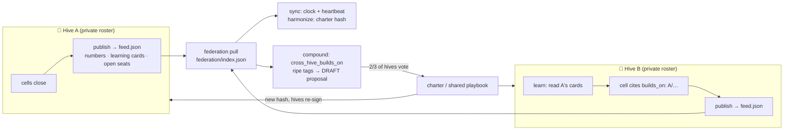

# Federation: how many school hives synchronize, harmonize and compound

Three levels: **the picture** (one minute), **the mechanisms** (ten minutes), **the handles** (for implementers).
Research and rationale are in §4; what this cannot see is in §5.

## §0 The request, evaluated

**Reflected back.** Paul asked for research into how different universities' Alumni Honeycombs can synchronize,
harmonize and compound, and for those mechanisms to be built into the system.

**What is weak in it, plainly.** There is one real circle today and zero registered real hives, so federation is
premature as an organisation. As a **protocol** it is cheap now and expensive later: if hive two records things
differently from hive one, nothing can be compared afterwards. So this builds the protocol (one clock, one feed
format, learning cards, a draft-only steward) and no organisation: no central database, no staff, no chain.

**The 10X, defined so it can fail** (`data/strategy.yml` T4): by **2027-06-30**, at least **1** cell in one real
school builds on a learning card from another real school (`cross_hive_builds_on ≥ 1`, simulated hives excluded).
If two hives exist and this stays 0, the hives coexist but do not compound. Then fix the reading step
(`learn`) before adding anything else.

**Decisions only Paul and the founders make:** which school is hive two; when the founding period ends (3 voting hives,
`FOUNDING_UNTIL_HIVES`); whether a ripe draft becomes a shared playbook (hives vote).

---

## Level 1 · The picture (one minute)

Think of a chain of restaurants where **every restaurant is owned and run by its own chef**. Nobody at head office
cooks. Three things still make it one chain:

1. **The same calendar.** Every kitchen changes its menu on the same four dates a year, and sends head office a short
   report each season. A kitchen that goes quiet is noticed. → **synchronize**
2. **The same recipe-card format, and a signed agreement.** Every kitchen writes its cards the same way, and the
   agreement on the wall carries a fingerprint anyone can check. → **harmonize**
3. **Every tested dish becomes a card the other kitchens can cook from.** A kitchen that uses another's card writes
   "adapted from Kitchen A". When the same kind of dish has worked in three kitchens in two cities, someone drafts it
   for the shared menu, and the chefs vote. The staff list never leaves the kitchen. → **compound**

## Level 2 · The mechanisms (ten minutes)

| Restaurant chain | Alumni Honeycomb | Exact handle |
|---|---|---|
| a kitchen run by its own chef | a **hive**: one school, its own people and rhythm | `hives-private/<school>.yml` (never committed) |
| the shared menu calendar | the **federation clock**: calendar quarters `YYYY-S1..S4` | `feed.season_of()`, enforced by `check.season_clock` |
| the season report to head office | the **public feed**, published at least once a season (the **heartbeat**) | `python -m honeycomb publish <hive.yml>` → `feed.json`, schema `ah-feed/1` |
| a kitchen that went quiet | heartbeat `late`: its latest season is older than the previous one | `federation.sync_status()` |
| the signed agreement on the wall | the **charter**, signed by SHA-256 in the feed | `feed.charter`, `federation.check()` |
| an older agreement still on the wall | an older ratified charter: allowed, flagged `older: re-sign` | `federation.sync_status()` |
| a tested recipe card | a **learning card**: a closed cell's tags, success criterion, evidence and what it learned. No names | `feed.learning_card()`, required by charter **P8** (`check.closed_shares_learning`) |
| "adapted from Kitchen A" | `builds_on: [<hive>/<cell>]` on the cell that used it | counted by `federation.cross_hive_builds_on()` |
| reading other kitchens' cards before cooking | ranked cards for a cell, before it acts | `python -m honeycomb learn <hive.yml> <cell>` (`learn.rank()`) |
| shifts that need covering | **open seats** in forming cells, by role | `feed.open_seat()` |
| a dish proven in 3 kitchens, 2 cities | a **ripe** tag: 3+ cards from 2+ hives → a DRAFT playbook | `federation.ripe_patterns()`, `status: draft` |
| the chefs vote on the shared menu | 2/3 of voting hives, one hive one vote | `federation.ratified()`; founding period: `status: founding`, `decided_by` |
| the staff list stays in the kitchen | a feed that names a member is refused | `feed.leaks()` inside `publish` |
| someone reads all the season reports | the **federation index**, rebuilt from every feed | `python -m honeycomb federation pull` → `federation/index.json` |
| a weekly check that reports still arrive | scheduled re-pull; a stale index or broken feed turns the run red | `.github/workflows/federation-heartbeat` (Mondays 06:00 UTC) |



The **steward** (the agentic part) only prepares: it pulls, checks, ranks cards and drafts proposals. It never
ratifies anything, never reads a roster from another school, and never contacts anyone. People decide.

## Level 3 · The handles (for implementers)

**A hive's feed** (`ah-feed/1`, `honeycomb/feed.py`; deterministic, because `as_of` comes from the hive's own dates):

```json
{"schema": "ah-feed/1", "hive": "example-b", "simulated": true,
 "charter": {"version": "1.0.0", "sha256": "4cc5…"}, "as_of": "2026-11-02",
 "seasons": ["2026-S3", "2026-S4"], "latest_season": "2026-S4",
 "pulse": {"active_cells": 0, "role_switchers": 5, "…": "aggregate numbers only"},
 "learnings": [{"id": "example-b/c-chem-ai", "tags": ["ai-study", "tutoring"], "builds_on": ["example/c-ai-tutor"],
                "vision": "…", "good": "Good: …", "evidence": "…", "learned": "…"}],
 "open_seats": [{"id": "example-b/c-history-ai", "tags": ["ai-study", "humanities"],
                 "needs": {"advisors": 1, "core": 1, "apprentices": 2}}]}
```

**The registry** (`data/federation.yml`): `charters[]` (every ratified version and its hash), `hives[]` (`id`,
`status`, `feed`: a repo path or an `https://` URL), `proposals[]` (`status: open | ratified | rejected | founding`).

**Commands** (all exit 1 on a problem, so they gate CI):

```bash
python -m honeycomb publish hives-private/<school>.yml --out <public>/feed.json   # refuses if check fails or a name leaks
python -m honeycomb federation check     # every feed signed with a ratified hash; proposals valid
python -m honeycomb federation pull      # merge feeds → federation/index.json (--check = drift gate)
python -m honeycomb learn hives-private/<school>.yml <cell-id>   # cards to read before acting
```

**Rules, in code:** P8 `check.closed_shares_learning` (closed ⇒ `tags` + `outcome.learned`; `builds_on` ids are
`<hive>/<cell>`); clock `check.season_clock` (season id = quarter of its start); ripe thresholds `RIPE_CARDS = 3`,
`RIPE_HIVES = 2`; founding period ends at `FOUNDING_UNTIL_HIVES = 3` voting hives.

**Tests:** `tests/test_federation_sync.py`. Each mechanism has a case that is shown failing on purpose: a late
heartbeat, an unratified signature, a leaking feed, an off-clock season, a founding decision after 3 hives, and a
ripe tag from a single hive.

## §4 Research: what long-lived federations teach, and where each lesson lives

| Source | The lesson | Where it lives here |
|---|---|---|
| Elinor Ostrom, *Governing the Commons* (1990): 8 design principles for long-lived commons | Local rules fit local conditions; those affected help make the rules; **monitoring** by accountable members; **nested enterprises** for larger systems | Hives make their own rules (charter covers only what must be shared); feeds are the monitoring; hive → federation is the nesting |
| Alcoholics Anonymous, Twelve Traditions, Tradition 4 | "Each group should be autonomous except in matters affecting other groups or A.A. as a whole." | The charter's `federation.autonomy` and `shared` lines; anything not in the charter is local |
| Robert Baden-Powell, *Scouting for Boys* (1908), the patrol system | Small youth-led groups of 6–8 with a leader chosen from among them, responsibilities passed around, the adult advising | The cell: a student CEO, alumni advisors, rotating roles (`role_switchers`) |
| Rotary International and Toastmasters | Independent clubs grouped into districts, with officer terms on a shared calendar | The season clock; a district layer is deliberately not built until hives exceed about ten |
| IETF, RFC 7282 *On Consensus and Humming in the IETF* (2014), and "rough consensus and running code" | Decide on evidence and objections, not on headcount alone; prefer what already runs | A ripe draft must cite the closed cells (running evidence) before anyone votes |
| McMahan et al., *Communication-Efficient Learning of Deep Networks from Decentralized Data* (AISTATS 2017, federated averaging) | **Share what was learned, not the raw data**; each site keeps its data | Feeds carry learning cards and numbers; rosters never leave the school (`feed.leaks`) |
| W3C ActivityPub (Recommendation, 2018) | Federation through each server publishing in a shared vocabulary, and others pulling | Each hive publishes `ah-feed/1`; the federation pulls by path or URL |
| Semantic versioning and signed releases | A contract changes by version, and anyone can verify which one they hold | Charter `version` + SHA-256; an older ratified version is valid but flagged |
| Etienne Wenger, *Communities of Practice* (1998) | Learning travels between groups through shared artefacts ("boundary objects") | Learning cards and tags are the boundary objects; a ripe tag is a community of practice forming across schools |

## §5 What this cannot see (named, so nobody over-trusts it)

- **A citation is not use.** `builds_on` counts what a cell says it built on. The cross-check is the evidence line
  of the citing card, read by a person.
- **Free text can still carry a name the roster does not know** (a teacher, a parent). `feed.leaks` checks member
  ids and names only, so operators still read their feed before publishing.
- **Tags are free text.** "ai-study" and "ai_learning" do not match, so ripe detection undercounts. Next step, when
  three real hives exist: a shared tag list in `data/` that the clock check also enforces.
- **A heartbeat proves a file was published, not that a cell met.** Check-ins and `active_cells` are the
  meeting-level signals.
- **Simulated hives are fiction.** `example` and `example-b` prove the mechanisms run; every 10X counts only
  non-simulated hives.

## What would change the design

- A token or chain: never while mainland China is a first market (see ARCHITECTURE §3).
- A district layer (hive → district → federation): when there are more than about ten hives, or two regions want
  different calendars.
- An LLM in `learn`: when there are hundreds of cards and tag-plus-word ranking visibly misses useful ones. Measure
  misses first.
