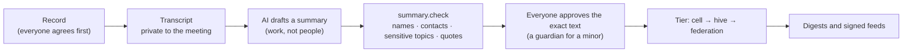

# The Honeycomb Toolkit: how 40,000 honeycombs talk, and what a CEO may share · 蜂巢工具箱

**One question:** in a beehive the size of Georgia Tech (about 40,000 students, up to as many honeycombs), how do
honeycombs learn from each other, how do beehives (Georgia Tech, Yale, UGA, UCLA, Berkeley, 中大…) talk, and what
community-owned, open-source tools does a CEO use to record, keep, share and exchange, without depending on a
commercial platform?
**This page does NOT answer** how proof of membership works ([MEMBERSHIP.md](MEMBERSHIP.md)) or the network's signed
feeds and Web3 choices in depth ([SCALE.md](SCALE.md)).

**Words.** A **honeycomb** (蜂房; `cell` in the code) is one team, one project, one season. A **beehive** (蜂巢; `hive`) is
one school. The **network** (联盟; `federation`) is all beehives.

**Honest status:** 0 real honeycombs yet. The message formats, the Release Agreement and the tools marked BUILT run and
are tested on simulated beehives.

## The picture: one kitchen, a city of restaurants, a national supply chain

A kitchen doesn't phone every other kitchen in the city. It writes its tested recipe on a card, files it under a topic
("braising", "pastry"), and anyone who follows that topic finds it in their weekly digest. If a cook needs help, the
manager asks another manager, and the two cooks meet only if both say yes. Between cities, the same cards travel in
sealed crates. The rule for the kitchen notebook: what happened in the kitchen stays there; only the recipe card,
with no cook's name on it, leaves, and only after everyone who cooked agrees to the card.

## The half-open system

| Open (each honeycomb drives itself) | Governed (the network coordinates) |
|---|---|
| Its project, its rhythm, its chat and video tools | The few message shapes everyone speaks |
| Its own recordings and notes, kept by its CEO | What may leave a meeting (the Release Agreement) |
| Who it recruits | How strangers meet (double opt-in introductions) |
| Leaving, forking, using any other tool | How a summary is signed and travels to other beehives |

## One protocol, three scales

Everything that moves between honeycombs is one of seven message shapes. The same shape works inside a beehive and
across the network; only the **release tier** changes (`cell` → `hive` → `federation`).

| Message | What it says | Handle |
|---|---|---|
| Honeycomb card | Vision, success line (Good:), tags, status | `cells[]` in the hive file |
| Open seat | The roles a forming honeycomb still needs, never the people | `feed.open_seat` (**built**) |
| Meeting summary | Purpose, decisions, next steps, what was learned, tags, asks, offers | `meetings[]`, `honeycomb/summary.py` (**built**) |
| Learning card | What a closed honeycomb observed and learned | `feed.learning_card` (**built**) |
| Ask / Offer | Help wanted, help available | in summaries and member cards (**built** as fields) |
| Introduction | "May I introduce you to…?", both must say yes | double opt-in (**planned**) |
| Heartbeat / vote | "We are alive this season"; a signed vote on a proposal | feed `latest_season`; `data/federation.yml` (**built**) |

## Inside one beehive: 40,000 honeycombs without chaos

All-to-all is impossible: 40,000 honeycombs would make 800 million pairs. Three mechanisms keep it to a few items per person a week:

1. **Topics, not people (publish and subscribe).** A honeycomb publishes its summaries under tags; a member follows a
   few tags. Work scales with the number of summaries plus the number of follows, never with pairs.
   `python -m honeycomb summary digest <hive.yml> --tags robotics,career` (**built**).
2. **A capped digest.** Each member sees at most 5 items a week, most shared tags first, then newest (`summary.digest`,
   **built**). Attention, not storage, is the scarce resource.
3. **Circles with a steward.** Honeycombs on one topic group into circles of about 10–15 (about 150 people, Dunbar's
   layer). A rotating circle steward reads the circle's summaries and proposes introductions across circles, favouring
   moderately weak ties (they move careers most; Rajkumar et al., Science 2022) (**planned**).

The arithmetic at full size: 40,000 honeycombs × one summary every 2 weeks ≈ 20,000 summaries a week, about 2 KB each, so
about 40 MB a week. That fits in static files split by tag and season, served from any host.

## Between beehives: Georgia Tech ↔ Yale ↔ UGA ↔ 中大

- Only summaries released to the `federation` tier travel. They go inside the beehive's **signed** feed, so any mirror can carry them (`feed.summaries`, Ed25519, **built**).
- Each beehive's digest can follow other beehives' tags. A Yale member who follows `robotics` sees Georgia Tech's released robotics summaries.
- Help across schools goes manager to manager. A Georgia Tech honeycomb's ask ("a biology alum to check explanations") shows up in Yale's digest. Yale's steward asks a Yale alum privately, and the two meet only on a double yes.
- At thousands of schools, feeds are split by tag and season, and cheap relays carry them (see SCALE.md). No single server reads everything.

## The Release Agreement (the CEO's low-level rules)

Based on the Chatham House Rule (1927, rev. 2002): use what you learned, never reveal who said it. One step is added:
**every person in the meeting approves the exact text before it leaves.** Data: `data/release.yml`. Enforced by
`summary.check` before any release.

| Layer | Who keeps it | Who can read it | Released? |
|---|---|---|---|
| Audio | The CEO, only if everyone agreed to keep it; encrypted; deleted within 90 days | No one else | Never |
| Transcript | The CEO | People who were in the meeting | Never |
| Summary | The honeycomb | The tier everyone approved | Yes, after `summary.check` passes and all approve |

**Never released:**
- Names, ids, emails or phone numbers.
- Health, mental health, faith practice, family conflict, money or legal matters.
- Anything about a minor beyond "a student under 18 took part".
- A company's confidential numbers.
- Quotes over 25 words, or any quote without its speaker's yes.

Anyone can withdraw approval later; the summary then drops back to the honeycomb.

## The CEO's toolkit (open source, MIT, built and maintained by the community)

| Job | Tool | Status | Run |
|---|---|---|---|
| Record, transcribe, draft notes | The room recorder: consent first, Whisper transcript, audio not stored, AI drafts | **built** for the owner; one per CEO is **planned** (needs member sign-in) | futuremake.io/honeycomb/room.html |
| Transcribe offline (privacy, mainland China) | whisper.cpp on the CEO's own laptop (open source) | use existing | `whisper.cpp` |
| Summarize and release | The Release Agreement checker | **built** | `python -m honeycomb summary check <hive.yml>` |
| Keep (storage) | The honeycomb's own files: YAML/Markdown in a folder or private git repo the CEO owns | **built** (format) | `hives-private/<school>.yml` |
| Publish and sign | Signed feed | **built** | `python -m honeycomb publish <hive.yml>` |
| Discover | Digest by tags; lessons for a honeycomb; recruit shortlist | **built** | `summary digest`, `learn`, `recruit` |
| Introduce | Double opt-in introductions | **planned** | — |
| Talk (chat, video) | Matrix/Element (chat, open source, federated) and Jitsi Meet (video, open source). WeChat and Zoom are fine too | use existing, don't build | — |
| Decide together | Proposals and 2/3 votes | **built** | `data/federation.yml`, `federation check` |
| Move to or from another system | Plain formats: YAML/Markdown, JSON feeds, RSS/ActivityPub for summaries, iCal for meetings, W3C Verifiable Credentials for membership | JSON/YAML **built**; the rest **planned** | — |

**Why build only these:** chat and video are already solved by open-source projects with millions of users. What
nobody else gives a honeycomb is the release discipline, the signed exchange and the digest. Those are the parts
here, and they are small.

**How the community owns it:**
- It is one MIT repo, and anyone can fork it.
- A new tool joins with a test that shows it keeps the Release Agreement and the charter.
- `make check` is the contract.
- Tools are free inside the network (P7).

## The 12X, defined so it can fail

| Measure | Target | Measured by |
|---|---|---|
| Names or contacts in released summaries | 0 | `summary.check` before release; `feed.leaks` at publish |
| Items a member is shown per week | ≤ 5 | `summary.digest` cap |
| From meeting to every follower of its tags | ≤ 48 hours | timestamps, once real honeycombs run |
| Tools contributed by people outside the founding team | ≥ 1 by the time a third beehive joins (T3) | merged PRs |

## Research (read 2026-11-27)

| Fact | Source |
|---|---|
| Chatham House Rule: use the information, never reveal the speaker or their affiliation (1927, rev. 2002) | chathamhouse.org |
| Dunbar's layers ≈ 5 / 15 / 50 / 150 | Zhou, Sornette, Hill & Dunbar, Proc R Soc B (2005) |
| Moderately weak ties move careers most (20M LinkedIn users) | Rajkumar et al., Science 377:1304 (2022) |
| Matrix: open, federated chat; about 190M known users (2025) | Matrix.org Foundation annual report |
| All-party consent to record in some US states (e.g. Florida, § 934.03) | Florida Statutes |
| Personal data stays inside a beehive; data with no personal information is outside China's cross-border rules | CAC Provisions 2024 Art. 3 |

**What this cannot see:** whether a summary is true (only that it names no one and everyone approved it), and whether
people read their digest. The first is checked by the honeycomb's own evidence (P3); the second by whether introductions
happen.
